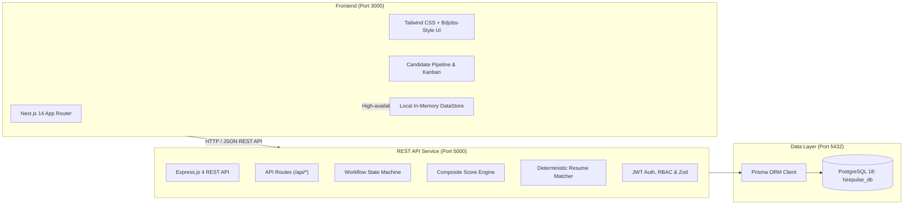

# NZTech Careers & Recruitment AI Platform

[](https://nextjs.org/)
[](https://expressjs.com/)
[](https://www.typescriptlang.org/)
[](https://www.postgresql.org/)
[](https://www.prisma.io/)
[](https://vitest.dev/)

An enterprise-grade talent acquisition ecosystem combining a high-impact **Public Careers Portal** (inspired by premier job boards like Bdjobs and Seek) with a governed **Enterprise Applicant Tracking System (ATS)** powered by deterministic NLP qualification matching and multi-criteria interview scoring.

---

## Architecture Overview

NZTech is structured as a decoupled monorepo separating presentation from backend business logic and database persistence:



---

## Directory Structure

```
NZTech/
├── frontend/                     # Next.js 14 App Router, TypeScript & Tailwind CSS (Port 3000)
│   ├── src/app/                  # Application pages (Home, Jobs, Applications, Dashboard, Auth)
│   │   ├── api/                  # Serverless API routes with hybrid database/store fallback
│   │   ├── applications/         # ATS candidate pipeline, scorecard, and Kanban views
│   │   ├── apply/                # Candidate job application & CV submission flow
│   │   ├── dashboard/            # Recruiter analytics, stage funnels, and metrics
│   │   ├── jobs/                 # Public job catalog with keyword & department filtering
│   │   ├── login/ & register/    # Authentication pages
│   │   └── page.tsx              # Bdjobs-style high-conversion careers homepage
│   ├── src/components/           # Modular UI components (Navbar, Footer, ScoreGauge, Badges)
│   ├── src/lib/                  # Client utilities (aiMatcher, scoreCalculator, workflow)
│   ├── tests/                    # 11 frontend unit tests (Vitest)
│   ├── package.json
│   └── tsconfig.json
├── backend/                      # Standalone Express.js REST API (Port 5000)
│   ├── src/controllers/          # HTTP controllers (Auth, Jobs, Applications, Reviews, Analytics)
│   ├── src/routes/               # Route endpoints with RBAC & schema validation
│   ├── src/services/             # Pure domain services:
│   │   ├── workflowService.ts    # Governed candidate state machine
│   │   ├── scoreService.ts       # Multi-criteria weighted composite scoring
│   │   └── aiService.ts          # Deterministic NLP resume matching & heuristics
│   ├── src/middlewares/          # JWT bearer verification, RBAC guards, and Zod validators
│   ├── prisma/schema.prisma      # PostgreSQL 18 relational schema
│   ├── tests/                    # 12 backend unit tests (Vitest)
│   ├── package.json
│   └── tsconfig.json
├── docs/                         # Technical documentation & specifications
│   ├── ARCHITECTURE.md           # System topology, state transitions & entity relationships
│   ├── API_SPECIFICATION.md      # OpenAPI/REST API endpoint contracts & schemas
│   ├── DEPLOYMENT_GUIDE.md       # Local development & Vercel production deployment
│   └── resume-matching-engine.md # Detailed NLP heuristic algorithms & formulas
├── scripts/                      # Developer automation batch scripts
│   ├── run-all.bat               # Simultaneous launcher (PostgreSQL + Express + Next.js)
│   ├── run-backend.bat           # Dedicated Express API launcher
│   ├── run-frontend.bat          # Dedicated Next.js frontend launcher
│   └── start-postgres.bat        # PostgreSQL 18 service launcher
├── run-all.bat                   # Root convenience wrapper
├── run-backend.bat               # Root convenience wrapper
├── run-frontend.bat              # Root convenience wrapper
├── start-postgres.bat            # Root convenience wrapper
├── vercel.json                   # Vercel deployment configuration
├── package.json                  # Root monorepo workspace scripts
└── README.md
```

---

## Core Capabilities

### 1. High-Impact Public Careers Portal (Bdjobs Style)
* **Multi-Field Search Bar**: Instant querying by job title, technical category, and regional hub (Auckland, Wellington, Christchurch, Dhaka).
* **Trending Role Chips**: Quick-filter shortcuts for in-demand roles (Full-Stack, React, Cloud, DevOps).
* **Industry Sector Taxonomy**: 8 curated functional categories displaying active vacancy counts.
* **Hot Jobs Showcase**: High-priority vacancies with salary badges, application deadlines, and employer avatars.
* **Corporate Header & Footer**: 24/7 applicant support hotlines, candidate newsletter subscriptions, and compliance links.

### 2. Governed Recruitment Pipeline State Machine
Candidate applications follow a deterministic, acyclic state machine rather than arbitrary status updates:

$$\text{APPLIED} \longrightarrow \text{SCREENING} \longrightarrow \text{AI\_ANALYZED} \longrightarrow \text{INTERVIEW\_SCHEDULED} \longrightarrow \text{OFFER\_EXTENDED} \longrightarrow \text{HIRED} \mid \text{REJECTED}$$

* **Prerequisite Enforcement**: Advancing to `OFFER_EXTENDED` requires at least one recorded technical or culture review.
* **Audit Trail Compliance**: Rejections require an explicit compliance rationale code logged in the immutable audit trail.
* **Privileged Transitions**: Reopening rejected profiles requires administrative privileges (`ADMIN`).

### 3. Dual-Mode Resume Evaluation Engine
* **Deterministic NLP Heuristics (Default)**: Tokenization, canonical synonym mapping (e.g. `Next.js` $\rightarrow$ `React`, `PSQL` $\rightarrow$ `PostgreSQL`), seniority benchmark ratios, and vocabulary density. Runs locally with zero external network overhead.
* **Generative LLM Augmentation (Optional)**: Automatically triggers when `GEMINI_API_KEY` is present, generating nuanced candidate summaries and behavioral interview prompts.
* Detailed design specification: [`docs/resume-matching-engine.md`](docs/resume-matching-engine.md).

### 4. Multi-Criteria Composite Scoring
Hiring decisions are calculated using a balanced weighted composite formula to prevent reliance on single subjective reviews or keyword stuffing:

$$\text{Composite Score} = (\text{AI Resume Score} \times 0.30) + (\text{Technical Interview} \times 0.45) + (\text{Culture Fit} \times 0.25)$$

---

## Technical Stack

| Layer | Technologies | Purpose |
| :--- | :--- | :--- |
| **Frontend** | Next.js 14, React 18, TypeScript 5, Tailwind CSS, Lucide Icons | Responsive UI, SSR & client-side caching, dynamic pipeline views |
| **Backend** | Node.js 20+, Express.js 4, TypeScript 5, Zod, bcryptjs, jsonwebtoken | Layered service architecture, schema validation, token authentication |
| **Database** | PostgreSQL 18, Prisma ORM 5 | ACID compliance, foreign-key cascade rules, migrations, connection pooling |
| **Testing** | Vitest | 23 automated unit and integration tests across business logic |
| **Tooling** | TSX, Morgan, CORS, Git | Hot-reloading development runner, HTTP logging, cross-origin security |

---

## Quick Start (Local Development)

### 1. Prerequisites
* **Node.js**: v18.0.0 or higher (v20+ recommended)
* **PostgreSQL**: 18.x running locally on port `5432`

### 2. One-Click Launch (Windows)
Double-click [`run-all.bat`](./run-all.bat) at the root of the project to start PostgreSQL, the Express API (Port 5000), and the Next.js frontend (Port 3000) simultaneously.

### 3. Monorepo CLI Commands
```bash
# Install dependencies across all workspaces:
npm install

# Run database migration / schema push:
npm run db:push

# Run full automated test suite (frontend + backend):
npm run test

# Launch services individually:
npm run dev:backend      # REST API on http://localhost:5000
npm run dev:frontend     # Client on http://localhost:3000
```

---

## Automated Testing Suite

The repository contains 23 comprehensive unit tests validating core domain logic:

```bash
# Run all tests across both packages:
npm run test

# Frontend tests (11 tests):
# - AI Resume Matcher Heuristics
# - Composite Score Calculations
# - Pipeline State Machine Transitions
npm run test:frontend

# Backend tests (12 tests):
# - Workflow Transition Rules & RBAC Permissions
# - Score Service Weighting & Multi-Review Averaging
# - Synonym Matching & Experience Normalization
npm run test:backend
```

---

## Default Demo Accounts

For demonstration and testing purposes, pre-configured database accounts are available:

| Role | Email | Password | Scope |
| :--- | :--- | :--- | :--- |
| **Admin** | `admin@hirepulse.nz` | `Password123!` | System administration, role assignment, stage overrides |
| **Recruiter** | `recruiter@hirepulse.nz` | `Password123!` | Job posting, candidate stage advancement, AI analysis |
| **Reviewer** | `lead.dev@hirepulse.nz` | `Password123!` | Technical and culture interview scoring |
| **Applicant** | `s@gmail.com` | `Shuvo5462` | Public job board view and application tracking |

---

## Documentation Index

* [System Architecture Specification](docs/ARCHITECTURE.md)
* [REST API Endpoint Contract](docs/API_SPECIFICATION.md)
* [Deployment & Production Guide](docs/DEPLOYMENT_GUIDE.md)
* [AI Resume Matching Engine Whitepaper](docs/resume-matching-engine.md)

---

## License

MIT
