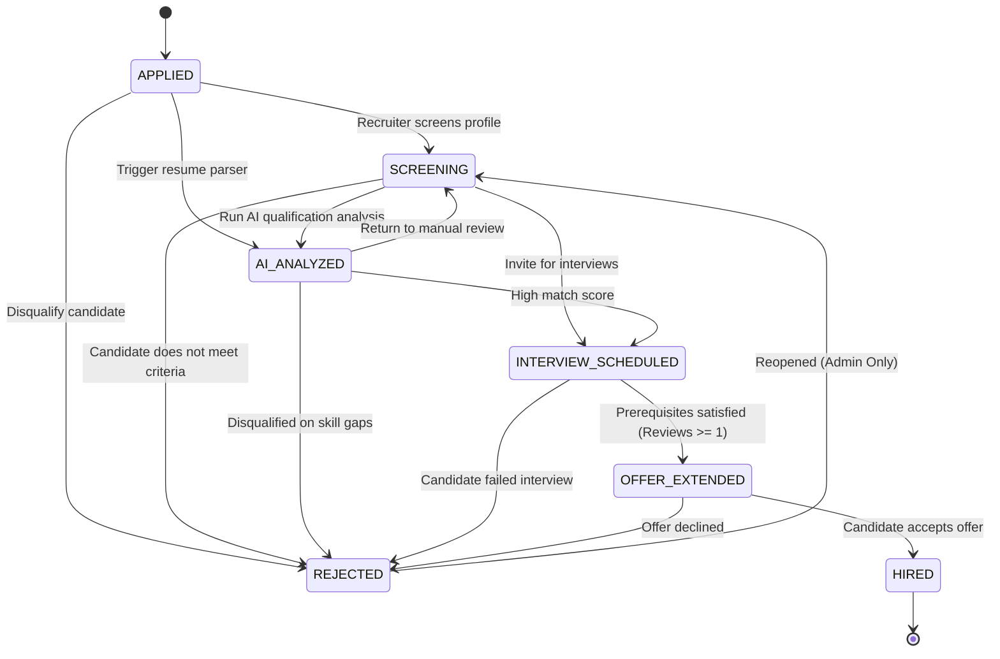
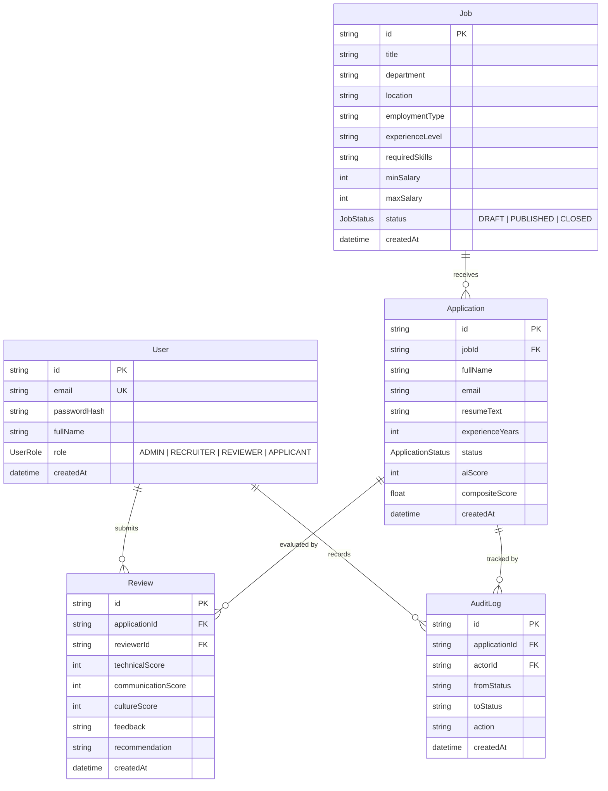

# NZTech Careers & Recruitment AI Platform
## System Architecture & Technical Design Specification

---

## 1. Executive Summary & Topology

**NZTech Careers** is an enterprise-grade recruitment ecosystem combining:
1. **Public Job Board & Career Portal**: High-conversion candidate discovery engine inspired by leading job boards (Bdjobs, Seek), featuring faceted search, industry taxonomy, trending role chips, live metrics, and streamlined application flows.
2. **Enterprise ATS (Applicant Tracking System)**: Governed recruitment workflow engine featuring a deterministic finite state machine, role-based access control (RBAC), multi-criteria interview scoring, and automated candidate-to-job qualification alignment.

The platform is structured as a decoupled full-stack monorepo:

```mermaid
flowchart TD
    subgraph ClientLayer ["Frontend Client Layer (Port 3000)"]
        UI["Next.js 14 App Router + Tailwind CSS"]
        PublicPortal["Public Discovery Portal (Bdjobs style)"]
        ATSApp["Recruiter & Reviewer ATS Management"]
        LocalDataFallback["In-Memory Resilient DataStore (dataStore.ts)"]
    end

    subgraph APILayer ["Backend REST API Service (Port 5000)"]
        Express["Express.js 4 + TypeScript 5"]
        AuthMiddleware["JWT Authentication & RBAC Guard"]
        ZodValidator["Zod Request Payload Validation"]
        
        subgraph CoreServices ["Domain Services"]
            StateMachine["Workflow State Machine (workflowService.ts)"]
            ScoreEngine["Composite Scoring Engine (scoreService.ts)"]
            ResumeAI["Deterministic NLP Resume Matcher (aiService.ts)"]
        end
    end

    subgraph DataLayer ["Data & Persistence Layer (Port 5432)"]
        Prisma["Prisma ORM 5.x"]
        Postgres[("PostgreSQL 18: hirepulse_db")]
    end

    ClientLayer -->|HTTP / JSON (REST API)| APILayer
    APILayer --> Prisma
    Prisma --> Postgres
    ClientLayer -.->|Zero-latency offline fallback| LocalDataFallback
```

---

## 2. Public Career Portal vs. Enterprise ATS

| Feature Pillar | Public Job Portal (Bdjobs style) | Enterprise ATS |
| :--- | :--- | :--- |
| **Primary Audience** | Job seekers, software engineers, public applicants | HR directors, technical hiring managers, interview reviewers |
| **Core Functions** | Multi-criteria search (keyword, industry, location), hot job badges, deadline indicators, instant CV submission | Candidate pipeline Kanban, stage progression, interview scorecard submission, audit trail |
| **Authentication** | Public browsing; lightweight applicant account tracking | Stateless JWT Bearer tokens with strict RBAC (`ADMIN`, `RECRUITER`, `REVIEWER`) |
| **Data Flow** | Job requisitions cached with fallback; one-click apply modal | ACID transactions with relational cascade rules on PostgreSQL 18 |

---

## 3. Governed Recruitment Pipeline State Machine

Rather than allowing arbitrary status modifications, candidate applications transition through a strictly governed finite state machine:



### State Machine Constraints:
1. **Offer Prerequisite**: Advancing to `OFFER_EXTENDED` requires at least one recorded technical or culture review score (`reviewCount >= 1`).
2. **Rejection Audit Requirement**: Transitions to `REJECTED` require an explicit explanatory reason of at least 5 characters for compliance and audit logging.
3. **Privileged Reopening**: Once marked `REJECTED`, only users with the `ADMIN` role can reopen the application to `SCREENING`.

---

## 4. Multi-Criteria Composite Scoring Engine

To eliminate human subjectivity and avoid bias from keyword stuffing, candidate decisions utilize a balanced weighted formula:

$$\text{Composite Score} = (\text{AI Resume Score} \times 0.30) + (\text{Technical Interview} \times 0.45) + (\text{Culture Fit} \times 0.25)$$

### Score Component Weights:
* **AI Resume Match (30%)**: Baseline qualification analysis based on skills overlap, seniority alignment, and token density.
* **Technical Interview (45%)**: Primary human evaluation submitted by technical leads (scored 1–10, normalized to percentage).
* **Communication & Culture Fit (25%)**: Collaborative peer assessment evaluating interpersonal and team dynamics (scored 1–10, normalized to percentage).

If no human reviews have been logged yet, the composite score defaults to the standalone AI Resume Score.

---

## 5. Dual-Mode Resume Evaluation Engine

The platform features a two-tier evaluation topology designed for high availability and zero external cloud dependency:

### Tier 1: Deterministic NLP Heuristic Matcher (Default)
* High throughput, executes locally in `<10ms` on Node.js without network roundtrips.
* **Canonical Synonym Dictionary**: Maps variations (`Next.js` $\rightarrow$ `React`, `PSQL` $\rightarrow$ `PostgreSQL`, `Express` $\rightarrow$ `Node.js`).
* **Seniority Normalization**: Compares candidate years of experience against target role benchmarks (`Junior`: 2y, `Mid`: 3y, `Senior`: 5y, `Lead`: 7y).
* **Deterministic Output**: Fit score (15–98%), Match level (`HIGH_MATCH`, `MODERATE_MATCH`, `LOW_MATCH`), and auto-generated technical interview questions based on missing skills.

### Tier 2: Generative Semantic Engine (Optional)
* Automatically triggered if `GEMINI_API_KEY` is provided in environment variables.
* Generates qualitative candidate summaries and tailored situational questions.

---

## 6. Relational Database Schema (PostgreSQL 18 via Prisma)


